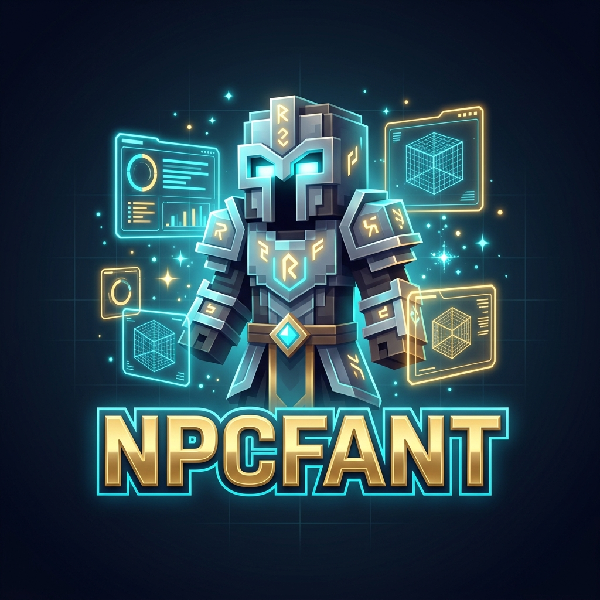

[](LICENSE)
[](https://modrinth.com/plugin/npcfant)
[](https://discord.gg/GS6hEw52BB)
[](https://www.minecraft.net)
[](https://www.java.com)
[](https://maven.apache.org/)

> ### 📥 **[¡Descárgalo aquí en Modrinth!](https://modrinth.com/plugin/npcfant)** — Versión 2.0.0 disponible ahora.

NpcFant is a modernized and feature-rich packet-based NPC plugin for Minecraft servers, providing administrators and developers with powerful tools to create interactive virtual characters, custom skins, and floating holograms.

NpcFant is maintained as an open collaboration project.

## What is NpcFant?

NpcFant is a comprehensive NPC management plugin that bridges high-performance packet rendering with ease of use. It combines advanced features for handling virtual `FakePlayer` entities, multi-type mob NPCs, interactive skin menus, floating holograms, and click action chains in one unified package.

With zero problematic external dependencies and native multi-version packet adapters powered by PacketEvents, NpcFant is designed to avoid version mismatch crashes and keep your server running at a solid 20 TPS.

## 📖 Documentation & Guides

For a complete breakdown of every feature, command, permission, and configuration setup, please see the **[Plugin Guide](GUIDE.md)**.

## Supported Versions

NpcFant supports Minecraft Java Edition versions **1.17 through 1.21.11** (and modern Paper/Spigot releases utilizing version mapping like `26.1` – `26.3`):
- **Spigot** - Complete support
- **Paper** - Full compatibility with modern Mojang mappings and Adventure APIs
- **Bukkit / Purpur** - Full Bukkit API compliance

Each version module is compiled separately ensuring optimal performance.

## 📥 Descarga e Instalación (Setting Up)

1. **[Descárgalo aquí en Modrinth](https://modrinth.com/plugin/npcfant)** y obtén la última versión `Npcfant-2.0.jar`.
2. Coloca `Npcfant-2.0.jar` en la carpeta `plugins/` de tu servidor.
3. Inicia o reinicia tu servidor.
4. Consulta la **[Guía Completa del Plugin](GUIDE.md)** para detalles de configuración, comandos y permisos.

## Skin System & GUI

NpcFant includes an asynchronous skin fetching and caching engine alongside an in-game GUI (`/skingui`):
* Fetch skins directly from premium Minecraft usernames (`username`), preset definitions (`preset`), or custom local YAML files (`file`).
* Runs all HTTP skin requests on a background thread to prevent server lag/TPS drop.

## Quick Commands Overview

### Main NPC Commands
- **/npcfant create `<type>` `<name>`**: Create a new NPC at your current location.
- **/npcfant remove `<npc>`**: Remove an existing NPC.
- **/npcfant clone `<npc>`**: Clone an NPC at your position.
- **/npcfant move `<npc>`**: Move an NPC to your current position.
- **/npcfant tp `<npc>`**: Teleport to an NPC.
- **/npcfant list** / **/npcfant info `[npc]`**: List all active NPCs or inspect details.

### Customization & Interaction Commands
- **/npcfant skin `<npc>` `<preset|file|username>` `<value>`**: Apply a custom skin to an NPC.
- **/npcfant name `<npc>` `<name>`**: Change an NPC's display name (supports `&` color codes).
- **/npcfant pose `<npc>` `<pose>`**: Set NPC posture (`standing`, `sneaking`, `sitting`, `sleeping`, `swimming`).
- **/npcfant equip `<npc>` `<slot>`**: Equip the item in your main hand onto the NPC.
- **/npcfant hologram `<npc>` `<add|set|remove|list>`**: Manage integrated floating hologram lines.
- **/npcfant action `<npc>` `<add|remove|list|clear>`**: Bind click actions (`cmd`, `console`, `opcmd`, `message`, `sound`, `server`).
- **/npcfant glow `<npc>` `<color|off>`** / **/npcfant invisible `<npc>`**: Toggle visual effects.
- **/skingui**: Receive the Skin Editor item or open the interactive Skin GUI (`/skingui open`).

For a full table of permissions, arguments, and details see the **[Guide commands section](GUIDE.md#commands-and-permissions)**.

## Build Instructions

1. Clone the repository:
   ```bash
   git clone https://github.com/Anonimous7800/Npc-Fant.git
   cd Npc-Fant
   ```

2. Run Maven build:
   ```bash
   mvn clean package -DskipTests
   ```

3. Locate compiled artifacts:
   - Shaded Jar: `NpcfantCore/target/Npcfant-2.0.jar`
   - Version adapters: Located in the `target` folder of each version module (`v1_17_R1` – `v26_3_R1`).

---

<div align="center">

**Made with ❤️ by anonimous1221 (plusstaff035@gmail.com)**

[GitHub](https://github.com/Anonimous7800/Npc-Fant) • [Discord Community](https://discord.gg/GS6hEw52BB) • [License](LICENSE) • [Plugin Guide](GUIDE.md)

Last updated: October 2026

</div>
